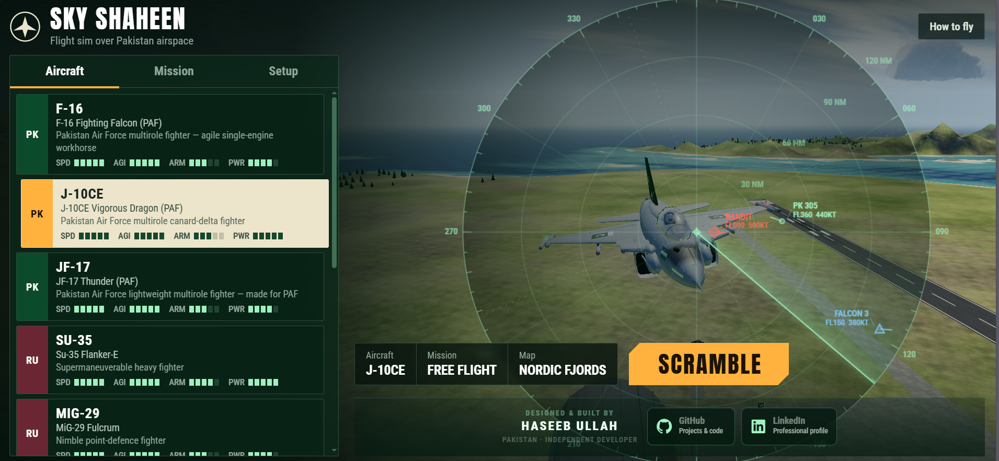
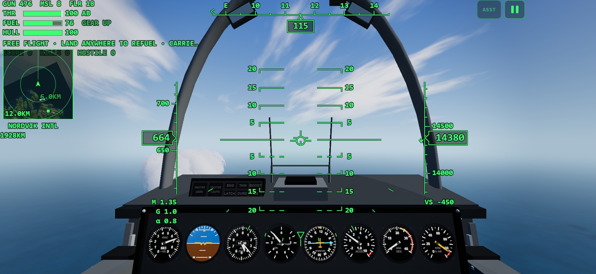

# SKY SHAHEEN

### Browser-based flight and air-combat simulator

Fly across Pakistan and other detailed environments in **Sky Shaheen**, a browser flight simulator with aircraft selection, free flight, combat missions, racing, carrier operations, wingman formations, and a configurable flight experience.


<p align="center">
  
 
  
  
  
</p>


## Highlights

- **Aircraft selection:** Choose from a range of aircraft, including fighters and other aircraft types.
- **Missions:** Free Flight, Air Race, Dogfight, Ground Strike, Intercept, Wave Assault, Landing Challenge, and Carrier Landing.
- **Wingman:** Call a wingman, form up, change sides, and command formation and airshow-style maneuvers.
- **Autopilot:** Take-off, landing, navigation, altitude/heading hold, space flight, and target-attack options.
- **Flight physics:** Flight energy, G-forces, stalls, flight-control assistance, and AI aircraft using the flight model.
- **HUD and radar:** Flight information, target tracking, missile-lock cues, ILS, and radar display.
- **Cockpit and camera views:** Cockpit, chase, padlock, fly-by, and orbit views, with look-around controls.
- **Carrier operations:** Catapult launches, carrier approaches, tail-hook landings, arresting wires, and go-arounds.
- **Maps and environments:** Pakistan, Nordic fjords, desert canyons, tropical islands, Pacific carrier setting, New York, Paris, London, and Rio de Janeiro.
- **Weather and time:** Select time-of-day and weather settings for different flight atmospheres.
- **Damage and targets:** Destructible scenery, ground targets, air targets, and combat effects.
- **Audio and feedback:** Procedural sound, gamepad support, and optional vibration/haptics on supported devices.
- **Phone-friendly controls:** Touch joystick, throttle, weapon controls, and optional tilt steering on supported secure/mobile browsers.
- **Offline build:** The game can be packaged as a single HTML file for offline play.


## Play

**Play Sky Shaheen online:** [Launch Game](https://sky-shaheen-3d-flight-combat.vercel.app/)
**Play Sky Shaheen online:** [Launch Game](https://haseeb45555.github.io/SKY-SHAHEEN-Pakistan-3D-flight-combat-simulator-Game/)

Open the game in a modern browser. On mobile, rotate your device to landscape for the best experience. On supported phones, use the install option in the browser to add it to your home screen.


## Controls

### Touch controls

| Control | Action |
|---|---|
| Left side / virtual stick | Pitch and roll |
| Right-side throttle | Adjust power; push into afterburner where available |
| Drag on the sky | Look around |
| GUN | Fire cannon |
| MSL | Launch locked missile |
| FLR | Release flares |
| TGT | Cycle targets |
| BRK | Speed brake / wheel brakes |
| GEAR | Landing gear |
| VIEW | Cycle camera |
| NAV | Cycle navigation point / airfield |
| AUTO | Autopilot menu |
| WING | Wingman commands |
| HOOK | Carrier landing tail hook |
| LATCH / MTR | Pylon and missile-motor functions |
| Pause | Pause and open help/settings |

### Keyboard and mouse

| Key | Action |
|---|---|
| `W` / `S` or Up / Down | Pitch |
| `A` / `D` or Left / Right | Roll |
| `Q` / `E` | Rudder |
| `Shift` / `Ctrl` | Throttle up / down |
| `1`–`4` | Throttle presets; `5` afterburner |
| `Space` | Cannon |
| `X` | Missile |
| `F` | Flares |
| `T` | Target cycle |
| `N` | Navigation / airfield cycle |
| `G` | Landing gear |
| `B` | Brake |
| `K` | Tail hook |
| `O` | Autopilot menu |
| `Y` | Wingman menu |
| `H` | Pylon latch function (hold for override) |
| `U` | Motor cut-off / relight |
| `V` | Cycle camera |
| `I` | Toggle HUD |
| `Esc` / `P` | Pause |

### Gamepad

Gamepads are supported. Default mapping includes left stick for flight, right stick for look, triggers/buttons for weapons, bumpers for throttle, and other buttons for target, brake, and autopilot controls.


## Install and run locally

Requires **Node.js 18 or newer**.

```bash
npm install
npm run dev
```

Open the local URL shown by Vite in your browser.

### Build a standalone offline HTML

```bash
npm install
npm run phone
```

The build creates `dist/Sky Shaheen.html`, a self-contained game file that can be copied to a device and opened in a browser. Tilt controls require a supported mobile browser context and are available from the online HTTPS version.


## Project scripts

| Command | Purpose |
|---|---|
| `npm run dev` | Start local development server |
| `npm run phone` | Build the standalone HTML version |
| `npm test` | Run flight-model and AI tests |
| `node tests/play.mjs` | Run automated mission/AI play test |
| `node tests/race.mjs` | Test air-race courses and scoring |
| `node tests/carrier.mjs` | Test carrier, autopilot, landing, and space-run systems |
| `node tests/shots.mjs` | Generate test screenshots (requires test environment) |


## License and credits

Sky Shaheen is released under the **MIT License** (see `LICENSE`). The bundled Three.js library is also MIT-licensed. Real-city map data includes © OpenStreetMap contributors (ODbL); Rio terrain is based on NASA SRTM data via OpenTopoData. See the project files for attribution and details.
